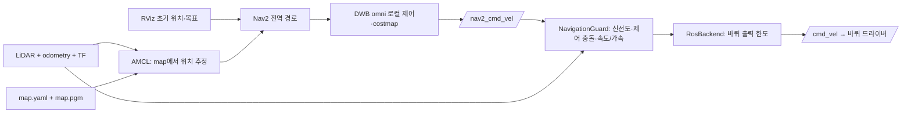

# LiDAR 주행 기록 → SLAM 지도 → Nav2 자율주행

이 기능은 **2D LaserScan + 바퀴 odometry + TF를 사용하는 ROS 2 Jazzy** 기준입니다. “SLAM”은 동시 위치 추정·지도 작성이며 Slack 메신저와 관계없습니다. 지도 작성과 Nav2 경로 계획·추종은 별도 머신러닝 학습 없이 동작합니다. 이후 정책 학습은 다른 단계이며 원본 주행 기록을 함께 보존합니다.

## 1. 저장하는 정보

기존 `lekiwi-episode-v1`의 `episode.json`, `samples.jsonl`, `commands.jsonl`, `frames/*.jpg` 형식은 유지합니다. 기록 화면의 **SLAM 지도용 센서도 기록** 옵션을 선택하면 다음 원본 ROS 메시지를 별도 프로세스에서 rosbag2 SQLite3/CDR로 추가 저장합니다.

| 기본 토픽 | 내용 | 2D 지도 필수 여부 |
| --- | --- | --- |
| `/scan` | LaserScan 전체 ranges/intensities, 각도·거리 범위·시간 정보·원본 frame/stamp | 필수 |
| `/odom` | Odometry 전체 pose/twist·quaternion·covariance·프레임·stamp | 필수 |
| `/tf` | 시간에 따른 좌표 변환 | odom→base 연결 필수 |
| `/tf_static` | LiDAR·본체·카메라 등 고정 외부 파라미터 | base→laser 연결에 필요. 같은 프레임이면 생략 가능 |
| `/imu/data` | 자세·각속도·가속도·covariance | 제공되는 경우 기록, 현재 SLAM Toolbox 입력에는 사용하지 않음 |
| `/joint_states` | 관절/바퀴 이름·위치·속도·effort | 제공되는 경우 기록 |
| `/points` | PointCloud2 원본 | 제공되는 경우 기록. 3D SLAM은 이번 구현 범위 밖 |
| `/cmd_vel`, `/motor_ready` | 실제 ROS 속도 명령·준비 피드백 | 제공되는 경우 기록. 지도 재생에서는 제외 |
| `/diagnostics`, `/battery_state` | 센서/기기 진단·배터리 상태 | 제공되는 경우 기록 |
| `/camera/camera_info` | 제공되는 ROS 카메라 내부 파라미터 | 선택. 기존 OpenCV 카메라가 이 토픽을 자동 생성하지는 않음 |
| `/amcl_pose`, `/plan`, `/local_plan`, `/goal_pose`, `/map` | 위치 추정·경로·목표·지도 | 해당 노드가 발행하는 경우 기록 |

ROS가 발행하지 않는 정보를 추정하거나 만들어 넣지 않습니다. 빈 선택 토픽은 counts=0입니다. IMU·바퀴 JointState가 없는 기기에서도 필수 센서/TF가 있으면 2D 지도 입력을 만들 수 있습니다. PointCloud2만 있는 LiDAR는 실제 장착 높이·각도에 맞는 `pointcloud_to_laserscan` 변환 또는 별도 3D SLAM 구성이 필요합니다.

원본 stamp/frame과 bag 수신 ROS 시각을 보존하고, ROS·wall·monotonic 시계의 시작/마지막 대응점을 manifest에 저장합니다. 이것은 소프트웨어 시각 대응점이며 하드웨어 노출/IMU/LiDAR 동기화를 보장하지 않습니다. 카메라 캡처 시각과 요청/발행/센서 상태 구분은 기존 기록에 유지합니다. ROS QoS/네트워크/디스크 상황에 따라 메시지 손실은 가능하며 “모든 발행 메시지 무손실”을 보장하지 않습니다.

```text
<episode-id>/
  episode.json           # 기존 형식 + slam 요약
  samples.jsonl          # 기존 학습용 요약
  commands.jsonl
  frames/                # 카메라가 있을 때
  slam/
    config.json          # 센서 토픽/프레임 설정, 인증 정보 없음
    bag/metadata.yaml
    bag/*.db3            # 원본 ROS CDR
    status.json          # 수신 수·필수 입력/TF·clock 상태
    manifest.json        # 종료/지도 입력 품질·시계 대응점
    capture.log
```

기존 에피소드 ZIP 다운로드가 이 하위 폴더도 포함합니다. PointCloud/지도/영상은 용량이 크므로 PC로 원본 폴더를 복사하는 것이 유리할 수 있습니다. 자동 업로드·삭제는 없습니다.

## 2. 최초 설정과 입력 확인

르키위: Ubuntu24.04 ARM64 + ROS2 Jazzy. 새 `prepare-system.sh`는 rosbag2 Python/SQLite 플러그인을 설치합니다. 기존 기기는 소스를 전환하는 것만으로 패키지가 설치되지 않습니다.

```bash
sudo apt-get update
sudo apt-get install ros-jazzy-rosbag2-py ros-jazzy-rosbag2-storage-default-plugins
source /opt/ros/jazzy/setup.bash
export ROS_DOMAIN_ID=42
export ROS_AUTOMATIC_DISCOVERY_RANGE=LOCALHOST
ros2 topic list -t
```

LiDAR 모델/드라이버는 저장소에 없으므로 실제 장치에 맞는 드라이버를 별도로 준비합니다. LiDAR·바퀴·기록 프로세스가 같은 ROS_DOMAIN_ID에 있어야 합니다. 같은 기기에서만 ROS 통신하도록 LOCALHOST discovery를 사용합니다. PC는 SSH/파일 복사로 기록을 가져오며 원격 DDS 통신이 꼭 필요한 경우만 별도로 검토하세요.

설정은 기존 `~/.config/lekiwi-phone/config.json`의 다른 필드를 보존하고 `slam` 객체만 추가/수정합니다. 전체 파일에는 PIN/AP 암호가 있으므로 출력하거나 저장소에 올리지 않습니다.

```json
{
  "slam": {
    "scan_topic": "/scan",
    "odom_topic": "/odom",
    "base_frame": "base_footprint",
    "odom_frame": "odom"
  }
}
```

위 예시는 전체 config를 대체하는 파일이 아닙니다. `base_frame`, `odom_frame`은 기본적으로 기존 바퀴 프로필에서 읽습니다. 토픽이 다르면 실제 이름을 설정합니다. `extra_topics`를 지정하면 선택 토픽 기본 목록을 대체하며, 토픽 이름→지원되는 ROS 메시지 타입의 객체로 지정합니다. `geometry_msgs/msg/TwistStamped`도 명시적 추가 토픽으로 지원합니다. 모르는 메시지 타입/중복 필수 토픽/잘못된 이름은 거부합니다.

필요한 TF는 다음과 같습니다.

```text
odom ── 동적 TF ──> base_footprint ── 실측 고정 TF ──> laser
                         └─ base_link 경유도 가능
```

프레임 이름을 임의로 바꾸거나 LiDAR 외부 파라미터를 모두 0으로 가정하지 마세요. 실제 장착 위치/방향과 드라이버 frame_id를 확인한 뒤 static_transform_publisher/URDF에서 지속 발행합니다. TF를 파일에 이름만 적는 것으로 연결이 생기지는 않습니다. 같은 transform을 여러 노드에서 중복 발행하지 않습니다. 바퀴 드라이버는 `/odom`과 odom→base TF를 제공해야 하며, 토크 비활성 상태의 드라이버/센서 확인은 현장 설정에 맞춰 진행합니다.

```bash
python3 tools/check_slam_sensors.py --seconds 5
```

이 명령은 구독만 하며 모터 전원/속도 요청을 보내지 않습니다. 입력 없음, 2초 넘게 오래된 scan/odom/동적 TF, 프레임 단절, 잘못된 scan/quaternion, scan/odom stamp 간 1초 초과 차이, 시각 역행, 중복 scan/odom 발행자는 실패로 표시합니다. tf_static은 transient-local로 이미 발행된 고정 변환도 구독합니다. 모터 준비 피드백과 물리적 정지는 별도로 확인해야 합니다.

## 3. 기록

폰에서 기존 PIN 인증 → 조종 시작 → 기록 화면 → 작업명 → **SLAM 지도용 센서도 기록** 선택 → 기록 시작 순서입니다. 옵션은 기본 선택돼 있지만 실제 ROS/rosbag2가 없는 데모에서는 비활성입니다. API 기존 클라이언트는 `slam`을 생략하면 기존 일반 기록 방식으로 동작합니다.

SLAM 모드는 카메라가 없어도 기록할 수 있습니다. 이때 영상/학습 유효 프레임은 생성하지 않으며 `training_valid=false`입니다. 영상 정책 학습까지 원하면 본체 카메라도 연결해야 합니다. 일반 기록 모드는 기존처럼 카메라가 필요합니다.

시작 시 최대8초 센서/TF를 확인하고 준비되지 않으면 실패 이유를 반환합니다. 기록 도중 필수 입력이 끊기거나 worker/디스크가 실패하면 불완전 기록으로 표시합니다. 기록은 별도 worker process이므로 ROS bag 디스크 쓰기가 모터 제어 루프에서 실행되지 않습니다. 기록 종료 시 0 명령/토크 해제를 요청하고, bag을 닫고 manifest를 작성한 후 ZIP을 제공합니다. 갑작스런 전원 차단은 bag 인덱스 복구가 필요할 수 있으며 이를 자동으로 완전한 기록으로 간주하지 않습니다.

저장 여유는 적어도 수GB를 권장합니다. rosbag worker는 256MiB 미만에서 중단하고 기존 이미지 writer의 128MiB 보호도 유지합니다. SSD 속도·QoS·센서 주기에 따른 수신 손실/지연은 실물에서 평가해야 합니다.

## 4. Ubuntu PC에서 지도 만들기

Ubuntu24.04 + ROS2 Jazzy가 설치된 PC에서 다음을 실행합니다. `tools/prepare_slam.sh`는 패키지만 설치하며 로봇/서비스/AP를 시작하지 않습니다. 현재 일반 Windows/macOS Python에서 ROS 없이 지도를 직접 생성하는 기능은 아닙니다. 추후 Ubuntu 노트북에서 사용하세요.

```bash
bash tools/prepare_slam.sh
source /opt/ros/jazzy/setup.bash
# 로봇에서 종료된 에피소드 폴더를 PC의 private/로 복사하거나 ZIP을 풉니다.
python3 tools/slam_map.py private/RECORDING_EPISODE --inspect-only
python3 tools/slam_map.py private/RECORDING_EPISODE \
  --output private/new-map --resolution 0.05 --rate 0.5
```

새 출력 폴더를 사용하며 기존 지도/기록을 덮어쓰지 않습니다. 지도 생성은 기본 ROS domain167, LOCALHOST discovery, use_sim_time=true, bag `/clock`으로 실행합니다. 실제 로봇 domain42를 거부합니다. node가 켜졌다는 이유로 완료 처리하지 않고 실제 `/map`의 장애물/빈 공간을 확인해 저장합니다.

원본 bag에서 **scan/odom/TF만** 별도 mapping-bag으로 정리하고 `/cmd_vel`·목표·모터 서비스 등은 재생하지 않습니다. 기존 지도/localization의 map→odom 변환도 제거해 새 SLAM의 map→odom과 충돌하지 않게 합니다. topic이 달라도 `/scan`, `/odom`으로 내부 정규화합니다. bag 자체를 직접 `ros2 bag play`하면 기록된 주행 명령도 발행될 수 있으므로 실물 domain에서 원본 bag을 통째로 재생하지 마세요.

출력:

- `map.pgm`, `map.yaml`: Nav2용 점유 격자 지도. 이미지 y축과 ROS 원점·해상도를 보존하며 unknown을 빈 공간으로 바꾸지 않습니다.
- `map.posegraph`, `map.data`: SerializePoseGraph 성공 시 연속 SLAM/추가 분석용 그래프.
- `mapping-bag/`, `slam-params.yaml`, `playback-qos.yaml`: 재현 입력/설정.
- `mapping-report.json`, `mapper.log`, `playback.log`: 메시지 수/프레임/지도 크기/시각/그래프 저장 결과.

그리드 저장 성공과 pose graph 저장 성공은 report에서 각각 확인합니다. 지도 생성 성공은 실내 지도 품질이나 실제 자율주행 성공을 보장하지 않습니다. 천천히 이동하고 회전 시 LiDAR/odometry가 안정적인지 확인하며, 같은 공간으로 되돌아오는 loop closure 경로를 포함해 수집하세요.

## 5. 저장한 지도에서 자율주행



AMCL은 `OmniMotionModel`, 로컬 제어는 전후·좌우 이동을 지원하는 DWB입니다. 로봇 **실측 외접 반경**을 필수 입력으로 받습니다. 팔·집게·케이블 등 돌출부를 포함해 현장에서 측정합니다. 실제 모터 방향·wheel geometry/ticks 한도·LiDAR 외부 파라미터와 costmap 범위를 먼저 검증합니다.

르키위의 기존 폰 서비스를 중지하고, 기존 서비스에서 사용하던 ROS와 workspace 환경을 source한 동일 로봇 사용자로 실행합니다. 관리형 설치는 system 서비스, 이전 설치는 user 서비스이므로 실제 유닛을 확인합니다. 모르는 다른 모터 제어 프로세스를 강제 종료하지 않습니다. 폰 서비스가 8090에서 응답하거나 다른 `/cmd_vel` 발행자가 있으면 자율주행을 거부합니다.

```bash
source /opt/ros/jazzy/setup.bash
# 실제 config에 지정된 workspace의 install/setup.bash도 source
# 폰 서비스 중지 예: systemctl --user stop lekiwi-phone.service
# 관리형 설치는 해당 system 유닛을 관리자 권한으로 중지
python3 tools/start_navigation.py --map /path/to/map.yaml \
  --robot-radius MEASURED_RADIUS_METERS --output private/nav-plan
```

기본 동작은 **설정 준비만** 하며 ROS 프로세스/모터를 시작하지 않습니다. config에는 PIN/AP 암호가 있어도 출력 nav2.yaml/plan에는 복사하지 않습니다. 현장 점검·정지 수단·주변 통제가 완료된 경우에만 새 output 경로로 다음을 실행합니다.

```bash
python3 tools/start_navigation.py --map /path/to/map.yaml \
  --robot-radius MEASURED_RADIUS_METERS --output private/nav-run --enable-motion
```

이 옵션은 실제 Nav2 목표가 0이 아닌 속도를 요청할 때 모터 활성화를 허용합니다. 알려진 torque-disabled 바퀴 노드와 센서/TF를 먼저 확인하며, **초기 위치는 RViz의 2D Pose Estimate**, 목표는 Nav2 Goal로 지정합니다. 실제 초기 위치를 알고 있을 때만 `--initial-pose X Y YAW`를 명시합니다. RViz도 domain42 및 같은 기기 환경에서 사용하거나 별도로 설계한 DDS 연결이 필요합니다. 웹앱에서 목표를 지정하는 UI는 이번 구현에 없습니다.

Nav2 출력을 `/nav2_cmd_vel`로 격리하고 guard만 `/cmd_vel`을 발행합니다. guard는 요청 이동 벡터0.1m/s·회전0.5rad/s 한도, 이동 가속0.2m/s²·회전 가속0.4rad/s², 기존 바퀴 비례 포화/ticks 제한을 적용합니다. **명령 300ms 중단·필수 센서/TF 2초 이상 중단·다른 발행자·모터/ROS 준비 이상은 0 명령과 비활성화를 요청하고 오류를 고정**합니다. 오류 후 자동 재활성화하지 않으며 운영자가 원인을 확인하고 재시작해야 합니다. 0 명령과 Ctrl+C도 정지/비활성화를 요청합니다. 폰 수동 모드의 기존 10초 단절 정책은 그대로이며 자율주행 guard는 별도의 300ms 정책입니다.

이 보호는 물리적 정지를 보장하는 안전 인증/독립 하드웨어 E-stop이 아닙니다. 센서 감시 2초 동안의 이동 가능 거리, 드라이버 timeout, 모터 통신 장애와 제동을 실제 장비에서 검증해야 합니다. 경로 계획의 장애물 회피도 실제 로봇 반경·센서 사각·지도 품질에 의존합니다. 운영 후 guard/Nav2를 종료하고 모터 상태를 확인한 뒤 폰 서비스를 다시 시작하세요.

## 6. 이후 정책 학습

Nav2 주행과 정책 학습은 구분합니다. 우선 사람이 수동으로 좋은 주행 시범을 수집하고 원본 episode/rosbag을 그대로 보존합니다. `requested_action`은 요청, `applied_action`은 출력 제한 후 발행 명령, `state`는 엔코더 기반 추정입니다. 세 값을 물리적 정답 속도로 혼동하지 않습니다.

기존 `export_lerobot.py`는 그대로 **이미지 + 상태6 + 행동3** 데이터셋을 생성합니다. LiDAR/IMU가 자동으로 기존 LeRobot feature에 추가되지는 않습니다. 멀티모달 정책을 학습하려면 bag의 센서 header stamp와 `clock_start/clock_latest`, `samples.jsonl`의 monotonic 캡처 시각을 검토해 센서 동기화/보간·결측 제외·정규화/캘리브레이션·명시적 feature 스키마를 설계해야 합니다. 이번에는 정책 trainer나 멀티모달 export를 구현하지 않았습니다. 지도/계획 토픽은 지도 기준 목표·경로 등의 후보 부가 정보로 보존합니다.

권장 후속 순서: 수동 시범 품질 검사 → 성공/실패·환경별 분리 → 학습/검증/테스트 경로 분리 → 오프라인 평가 → 물리 시뮬레이터 → 낮은 속도의 감독 하 실물 검증 → 동일 guard를 통하는 정책 출력. 촬영된 장소의 지도/위치와 기록은 필요한 범위에서 비공개 보관합니다.

## 하부 LiDAR의 초기 지도 확보

`patrol.wheel_filter_centers_deg`는 원시 scan 좌표의 세 바퀴 방향을 장비별로 지정합니다. 기본값은 기존 프로필 호환을 위해 유지됩니다. RoboSEasy 장비에서 확인한 방향은 [-60,60,180]도입니다. `patrol.self_return_radius=0.19`는 기존 장비의 navigation_scan.yaml을 근거로 선택하는 자체 반사 제거 프로필이며 기본값은 0입니다. 원시 /scan은 보존하고 거부한 광선은 NaN으로 처리합니다. 외곽이 20cm 이상으로 확인된 장비에서만 필터를 사용하고, 반사 제거 반경과 보수 외곽 사이에 최소 2cm를 둡니다. 센서/조립이 다른 장비에는 그대로 복사하지 않습니다.

웹앱에서 초기 지도 회전을 선택하면 모든 방향의 외곽 여유 30cm 이상 확인을 함께 요구합니다. Nav2 Spin으로 +60도, -60도를 수행하며 최대 회전 요청은 0.15rad/s입니다. 선형 명령, 엔코더 기준 3cm 초과 이탈, 센서·TF 이상, 취소, 시간 초과 또는 Nav2 충돌 판정 시 중단합니다. SLAM 입력은 초당 최대 4회 처리하여 제자리 회전 스캔도 지도에 반영합니다. 회전 완료 뒤 지도 갱신과 안전한 출발 지점을 확인한 경우에만 일반 목표 이동으로 넘어갑니다. 실제 시험 직전 랜선 분리 확인은 별도로 필요합니다.

`calibration.known_body_radius`는 실측된 중심 본체가 현재 점유하는 반경이며 기본 0, 최대 0.10m입니다. 이 값은 원시 지도 변경 없이 Planner의 현재 본체 내부 unknown 셀만 처리합니다. 셀 전체가 그 반경 안에 들어와야 하며 occupied 셀, 본체 밖 unknown, 로봇 외곽·여유 제한은 유지합니다. 보수 운행 반경(예:0.22m) 전체를 빈 공간으로 만들지 않습니다. 물리적 통과 공간을 추가로 검증하는 기능을 대체하지 않습니다.

참고: 사용자 제공 Notion의 [르키위 사용법](https://app.notion.com/p/6768cabd660f8237b0eb013fbacbb76a), 기기 내부 navigation_scan.yaml, SLAM Toolbox Jazzy shouldProcessScan 구현을 대조했습니다. 합성 통합 시험은 `python3 tests/ros_patrol_integration.py --round-trip --survey --output /절대/새/출력폴더`로 실행합니다. 합성 센서·가상 모터 결과는 실물 주행 검증과 구분합니다.

출발 검사 거리는 정확한 Euclidean distance transform으로 계산합니다. 로봇 외곽과 여유를 유지하고 장애물 셀과 후보 위치 셀의 반대쪽 모서리를 모두 고려해 셀 대각선만큼 보정합니다. 사각 격자(Chebyshev) 근사의 대각선 과소평가를 없애며, occupied/unknown 입력이나 원시 지도는 삭제하지 않습니다. 거리장은 무작위 작은 격자의 모든 최근접 거리와 직접 계산 결과를 대조해 검사합니다.

자율주행의 `mission.distance_m`는 웹 런타임이 수신한 엔코더 odometry의 누적 XY 이동량으로 계산합니다(`distance_source=wheel_odometry`). 초기 회전 이전 누적값은 목표 이동 시작 시 기준값으로 제외합니다. SLAM 보정이 섞인 지도 위치 누적은 `map_distance_m`로 별도 보고하며 순전진 거리나 물리 실측 주행거리로 해석하지 않습니다. 지도 점프, 엔코더 불연속/누적 역행, 센서·TF 중단 보호는 유지합니다. /tf는 여러 발행자가 하나의 토픽을 공유하므로 raw health 구독과 tf2 listener는 깊이10을 사용하고, scan/odom은 최신1개를 유지합니다. 오래된 TF를 정상으로 간주하도록 timeout을 늘리지 않습니다.

## 웹앱의 탐색·순회·복귀와 제한 시험

기본 운행 방식은 `patrol`(자동 탐색·순회 후 복귀), 기본 속도는1배입니다. 관측된 안전 지점 중 미관측 공간을 볼 수 있는 목표를 우선 선택하고, 관측된 도달 가능 영역의 미방문 지점을 방문합니다. 목표가 소진되거나 시간·순회·복귀 거리 예산 조건에 도달하면 복귀를 시도하고 `return_reason`을 보고합니다. 목표 실패 뒤 남은 후보가 없는 경우에도 전체 영역을 방문했다고 표시하지 않고 복귀를 시도합니다. 복귀 경로 자체가 없으면 정지합니다. 방 전체의 빈틈없는 청소 경로나 상용 수준 안전성을 보장하지 않습니다.

`straight_round_trip`은 별도 제한 시험입니다. 초기 회전 요청을 거부하고 DWB의 좌우/회전 속도를0으로 설정하며, 회전·우회 복구 동작이 없는 Nav2 BT를 사용합니다. guard는 비정상 옆 이동·회전 명령을 출력 전에 거부하고 정지·모터 비활성화를 요청합니다. 위치의 좌우 이탈3cm, 방향이탈0.05rad를 넘으면 중단합니다. 전방 거리 목표 도착 뒤 같은 방향을 유지하는 출발점 목표를 보내 후진 복귀하며, 직선 복귀 경로가 막히면 우회하지 않습니다. 기본 탐색 순회 기능과 구분합니다. 원형 외곽과 장애물/unknown 여유 검사는 그대로 유지하므로, 좁은 통로에서 출발이 차단될 수 있습니다.

자율주행 API의 `autonomy.output_motion`은 navigation guard의 출력 요청이며 실측 속도는 아닙니다. 최상위 `output_motion`은 수동 컨트롤러 값이므로 실제 자율주행 속도 관측에는 ROS `/cmd_vel`을 별도로 확인합니다. 기록 탭의 자율주행 샘플은 guard 요청·출력·센서 관측을 저장하고, 자율주행 시작 자체는 학습 기록을 자동 시작하지 않습니다.
